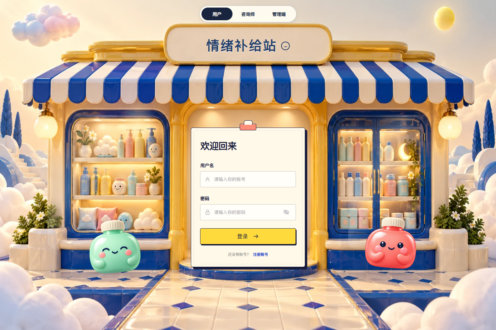
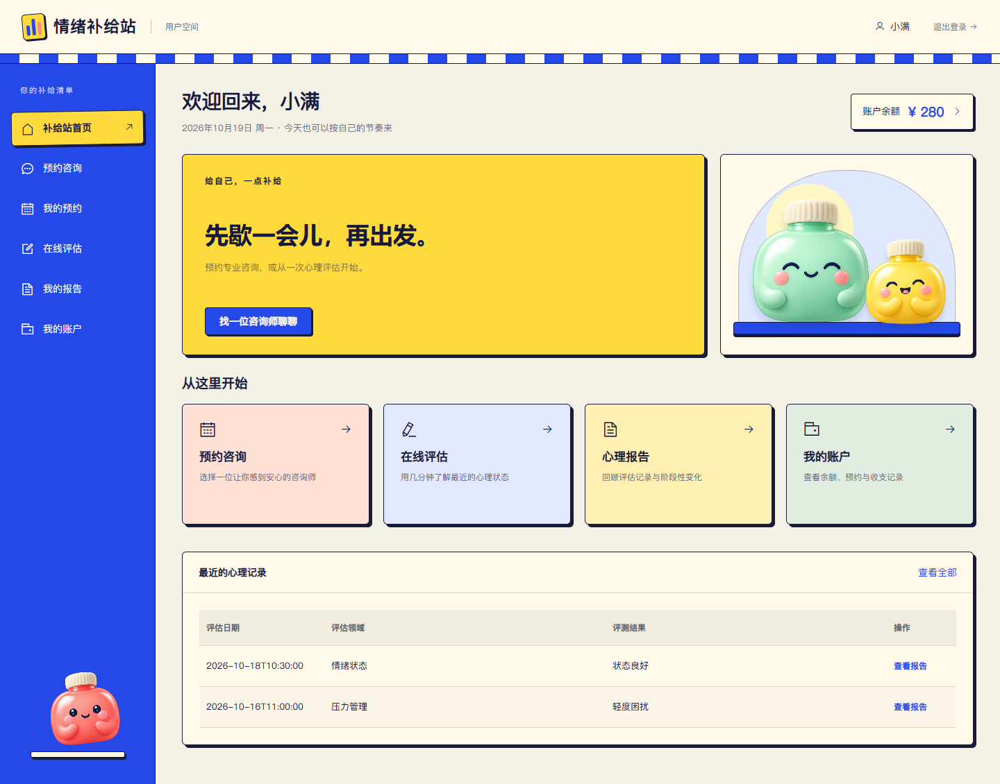
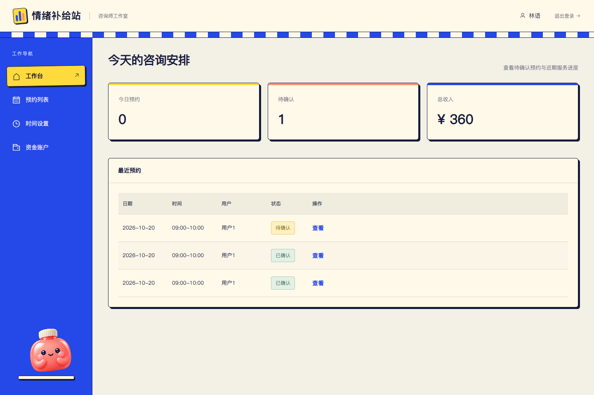
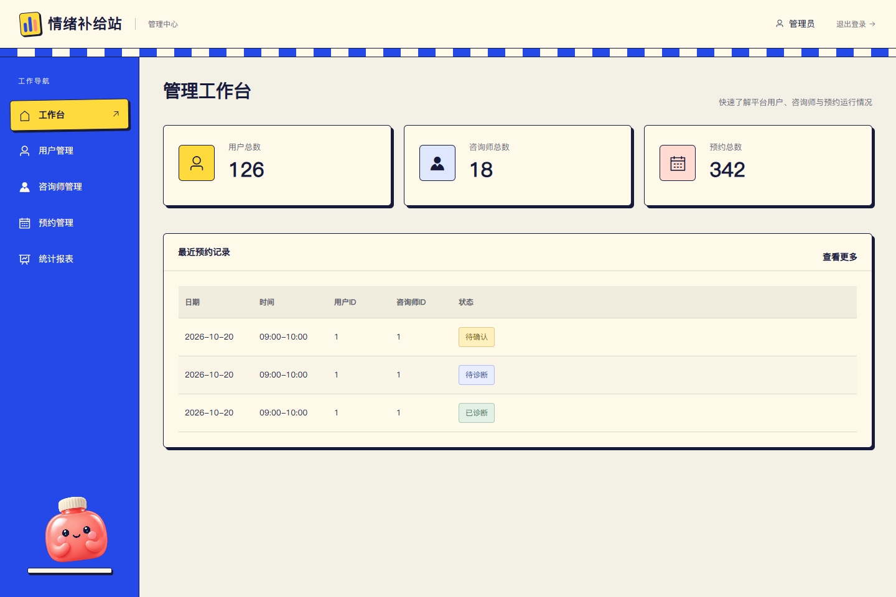

# 心理咨询与诊断平台

一个前后端分离的心理咨询平台。后端位于仓库根目录，使用 Spring Boot 2.7、MyBatis 和 MySQL；前端位于 [`frontend/`](frontend/)，使用 Vue 2、Vue Router、Element UI 和 Axios。

## 界面预览

> 以下截图使用本地模拟数据，仅用于展示界面与功能布局，不包含真实用户信息。

### 统一登录入口

<p align="center">
  
</p>

### 多角色工作台

<table>
  <tr>
    <th width="50%">用户端</th>
    <th width="50%">咨询师端</th>
  </tr>
  <tr>
    <td></td>
    <td></td>
  </tr>
  <tr>
    <td align="center">预约咨询、在线评估、报告与账户管理</td>
    <td align="center">预约处理、时间配置与资金账户</td>
  </tr>
</table>

### 管理端

<p align="center">
  
</p>

管理端提供用户、咨询师、预约及统计报表管理。

## 项目结构

```text
psychology_system/
├─ src/                 # 后端源码与测试
├─ deploy/              # 后端部署配置和数据库加固脚本
├─ frontend/            # Vue 前端项目
├─ Dockerfile           # 后端镜像
└─ pom.xml              # Maven 配置
```

## 本地运行

1. 准备 Java 8、Maven、Node.js、npm 和 MySQL 数据库。
2. 配置运行环境变量：

   - `DB_URL`：MySQL JDBC 地址。
   - `DB_USERNAME`：数据库用户名。
   - `DB_PASSWORD`：数据库密码。
   - `JWT_SECRET`：至少 32 个字符的随机密钥。
   - `JWT_EXPIRE_MILLIS`：Token 有效期，默认 24 小时。
   - `CORS_ALLOWED_ORIGINS`：逗号分隔的前端来源。
   - `DEMO_RECHARGE_ENABLED`：本地开发默认开启模拟充值；生产环境必须显式设为 `false`。

3. 在仓库根目录执行 `mvn test` 和 `mvn spring-boot:run` 启动后端。
4. 进入 `frontend/`，执行 `npm ci` 和 `npm run serve` 启动前端。

前端开发环境默认访问 `http://localhost:8080`，可通过 `frontend/.env.development` 调整。

生产部署使用 `application-prod.yml` 或容器配置，且必须显式提供 `JWT_SECRET` 和
`CORS_ALLOWED_ORIGINS`。

## 安全模型

- JWT 包含 `user`、`counselor` 或 `admin` 角色，服务端按接口前缀强制校验。
- 用户只能查看自己的评估报告；咨询师只能处理分配给自己的预约。
- 新密码使用 BCrypt。旧 MD5 密码仅在登录校验时兼容，并在首次成功登录后自动升级。
- 密码字段仅允许请求写入，任何 JSON 响应均不会序列化密码。
- 充值为本地模拟功能：成功后直接增加账户余额并写入账户流水，不连接微信或支付宝。生产配置默认关闭。

## 数据库加固

上线前备份数据库并执行 [deploy/2026-07-security-hardening.sql](deploy/2026-07-security-hardening.sql)。
脚本先列出重复数据，再添加用户名、预约时间配置唯一约束及常用查询索引。

## 测试

`mvn test` 覆盖以下关键场景：

- 不同角色之间的接口隔离。
- 咨询师预约归属校验。
- 预约时间段并发占用失败处理。
- 用户报告归属校验。
- BCrypt 密码与旧 MD5 密码迁移。

## 部署说明

后端容器不会以 root 用户运行。前端 Nginx 将 `/api/` 反向代理到后端服务，生产环境建议
只通过 HTTPS 暴露前端入口，不直接公开数据库和后端管理端口。
